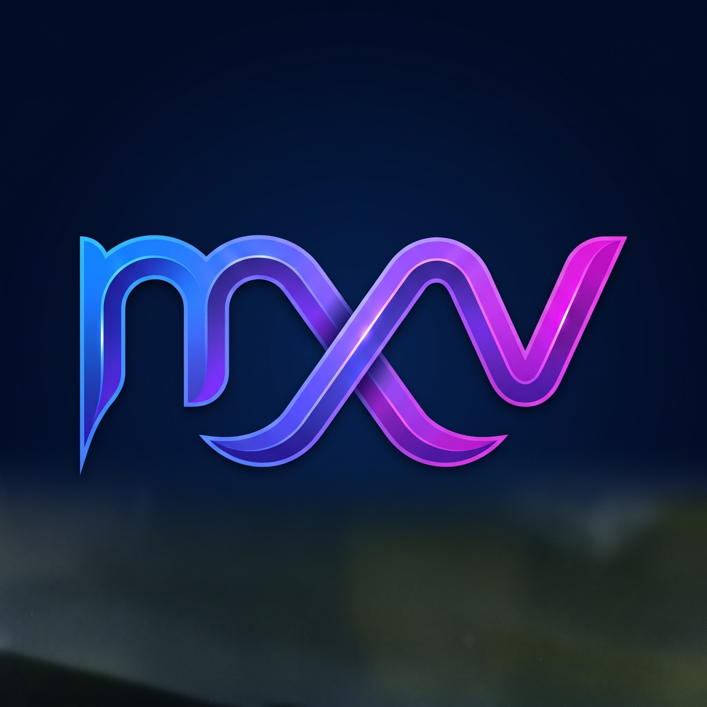

# mUzVidX 🎵🎬

<p align="center">
  
</p>

<p align="center">
  <b>Reproductor y Descargador Multimedia de Alta Fidelidad para Android</b><br>
  <i>Streaming y descarga en línea de Audio y Video con Visualizador FFT en tiempo real, Ecualizador de 5 bandas, Modo PiP y Conversión MP3 con FFmpeg</i>
</p>

<p align="center">
  
  
  
  
  
  
</p>

---

## 🎧 Novedades en v1.0.3: Reproductor Local Dedicado (M4A / MP3 / MP4)

mUzVidX v1.0.3 separa la experiencia de reproducción en línea de la reproducción local, incorporando un **Reproductor Local Exclusivo** para la pestaña de **Descargas** (`LocalPlayerActivity`):
- **Identidad Visual Propia y Brillante**: Interfaz luminosa con paleta menta-esmeralda y dorado eléctrico (`#00FFAA` / `#FFD600`) claramente diferenciada del reproductor de búsqueda en línea.
- **Soporte Nativo Local (.M4A, .MP3 y .MP4)**: Reproduce tus archivos descargados de audio y video con lectura automática de carátulas embebidas (ID3) y miniatura de video.
- **Insignia de Formato Local**: Muestra en tiempo real el formato del archivo reproducido (`LOCAL • MP3`, `LOCAL • M4A`, `LOCAL • MP4`).
- **Cola de Reproducción Local Continua**: Navega con **Anterior / Siguiente** y reproducción continua a través de toda tu biblioteca descargada con el mismo manejo completo (Ecualizador de 5 bandas, Visualizador FFT brillante, PiP, Repetición, Favoritos, Playlists y control remoto Android TV).

---

## 📺 Novedades en v1.0.2: Experiencia Nativa Android TV & Streaming 1080p

mUzVidX v1.0.2 introduce compatibilidad total para **Android TV**, **Google TV** y **TV Boxes** mediante una **única APK universal**. Gracias a la integración del lanzador Leanback, el mismo instalador se adapta a pantallas táctiles (smartphones/tablets) y televisores inteligentes.

### 🌟 Características Destacadas para TV:
- **Lanzador Leanback & Banner Panorámico**: La app aparece de forma nativa en la pantalla principal de Android TV con su banner oficial en alta definición (`banner_tv.png`).
- **Navegación 100% con Control Remoto (D-Pad)**: No requiere ratón ni puntero virtual. Desplazamiento fluido entre pestañas, buscador, resultados de contenido y controles de reproducción.
- **Indicadores Visuales de Foco**: Todos los elementos interactivos cuentan con bordes brillantes y realces de alto contraste (cian/magenta) para identificar claramente la posición del foco en pantallas grandes.
- **Mini Reproductor Inteligente**: Al presionar el botón `Atrás` en el reproductor de video/audio, la pantalla completa se minimiza suavemente al mini reproductor inferior sin pausar la música, permitiendo seguir buscando y navegando la biblioteca.
- **Streaming 1080p Nativo Inmutable (Sin Cortes a los 62s)**: Motor de extracción HLS (`VISIONOS` + `visitorData`) que suministra streams continuos oficiales de GoogleVideo en **1080p Full HD**. Elimina de raíz el corte forzado de los 62 segundos (límite de 15 MB de streams adaptativos directos) y evita la degradación a 360p. La resolución elegida se mantiene en el primer video y en todos los siguientes de la cola.

---

## 🎮 Guía de Uso con el Control Remoto (Android TV)

La interfaz de usuario ha sido adaptada para garantizar una experiencia de 10 pies (10-foot UI) fluida e intuitiva:

| Botón del Control | Función en la Interfaz de TV |
| :--- | :--- |
| **Cruceta (D-Pad)** `▲` `▼` `◄` `►` | Navega entre los botones de modo (*Canciones*, *Videos*, *Modo Libre*), campos de texto, lista de resultados y barra de reproducción. |
| **Botón OK / Centro** | Selecciona y reproduce la canción/video enfocado. En el reproductor: alterna Pausa/Reproducir. |
| **Botón Atrás (Back)** | **En Reproductor Pantalla Completa**: Minimiza al **Mini Reproductor** inferior sin detener el audio/video.<br>**En Mini Reproductor**: Con el foco en la `X`, cierra y detiene la reproducción.<br>**En Menús/Listas**: Regresa al foco o pantalla previa. |
| **Buscador (Search)** | Al seleccionar el campo de búsqueda con `OK`, se despliega el teclado virtual de Android TV. Al pulsar Enter, el foco salta automáticamente al primer resultado de la lista. |
| **Descargas & Conversor** | Botones dedicados con foco accesible para descargar en MP3 o Video directo. La pestaña **Conversor** permite transcodificar archivos locales usando el motor FFmpeg integrado con navegación D-Pad. |
| **Controles de Video** | En pantalla completa, presionar `▲` o `OK` despliega la barra de controles (selector de calidad, barra de progreso y modo audio). Los controles se ocultan solos tras 4 segundos de inactividad para visualización limpia. |

---

## 📲 Cómo Instalar en tu Smart TV

mUzVidX se distribuye como APK directa sin depender de tiendas restringidas. Puedes instalarla fácilmente mediante cualquiera de los siguientes métodos:

### Método 1: Instalación Inalámbrica por ADB (Recomendado para desarrolladores y usuarios avanzados)
1. **Activar Opciones de Desarrollador en la TV**:
   - Ve a `Ajustes` -> `Preferencias del dispositivo` -> `Información`.
   - Pulsa 7 veces consecutivas sobre **Compilación del SO de Android TV** hasta ver el mensaje *"¡Ya eres desarrollador!"*.
2. **Habilitar Depuración**:
   - Ve a `Opciones para desarrolladores` y activa **Depuración por USB** (o Depuración de red).
3. **Obtener la Dirección IP de la TV**:
   - Ve a `Ajustes` -> `Red e Internet` -> Tu red Wi-Fi/Ethernet conectada y anota la dirección IP (ejemplo: `192.168.1.69`).
4. **Instalar desde tu PC (Terminal)**:
   ```bash
   adb connect 192.168.1.69:5555
   ```
   *(Acepta el mensaje emergente en la pantalla del televisor: "Permitir siempre desde este equipo")*.
5. **Enviar la APK**:
   ```bash
   adb -s 192.168.1.69:5555 install -r mUzVidX-v1.0.2.apk
   ```

### Método 2: Instalación por Memoria USB (Pendrive)
1. Descarga el archivo `mUzVidX-v1.0.2.apk` en tu computadora y cópialo a una memoria USB (formato FAT32 o NTFS).
2. Conecta la memoria USB al puerto de tu Smart TV o TV Box.
3. En la TV, abre cualquier explorador de archivos (ej. *File Commander*, *X-plore* o *AnExplorer*, disponibles en Google Play Store de la TV).
4. Si la TV te lo solicita, activa el permiso para **"Instalar aplicaciones desconocidas"** para ese explorador.
5. Selecciona el archivo APK en la memoria USB y presiona **Instalar**. ¡Listo! La app aparecerá en tu fila de aplicaciones de la pantalla de inicio.

---

## 🌟 Características Principales

### 🎧 Reproducción y Streaming Dual (Audio & Video)
- **Cambio Dinámico Audio / Video**: Switch en vivo para alternar entre modo sólo audio (óptimo para ahorro de batería/datos) y modo video de alta definición sin perder la posición de reproducción.
- **Reproducción Continua en Segundo Plano**: Soporte completo para reproducción en background y control desde la barra de notificaciones del sistema (`MediaSessionService`).
- **Modo Picture-in-Picture (PiP)**: Minimiza el video a una ventana flotante para continuar viendo tus contenidos mientras usas otras aplicaciones.
- **Vistas Inteligentes (Vertical y Horizontal 50/50)**: En orientación horizontal, activa una vista dividida sincronizada: 50% video HD y 50% visualizador espectral de audio.

### 📊 Visualizador de Audio Espectral FFT en Tiempo Real
- **36 Bandas de Frecuencia**: Análisis acústico reactivo dividido en **Graves** (12 bandas), **Medios** (12 bandas) y **Agudos** (12 bandas).
- **Física de Cápsulas de Pico (Peak Caps)**: Caída por gravedad balística y desvanecimiento suave para una respuesta visual orgánica y precisa con cada beat musical.
- **Modo Minimalista**: Opción para alternar entre la carátula HD del álbum y el visualizador reactivo de ondas sonoras.

### 🎚️ Ecualizador Paramétrico de 5 Bandas & Presets
- Control de ganancia en decibelios en 5 rangos de frecuencia clave (60Hz, 230Hz, 910Hz, 3.6kHz, 14kHz).
- Presets optimizados: Normal, Bass Boost, Rock, Pop, Jazz, Clásica, Vocal y Custom.

### 🔍 Modos de Búsqueda Deterministas y Fieles (Sin Conmutaciones Forzadas)
- **Canciones (YouTube Music)**: Catálogo oficial de estudio (Art Tracks). Audio refinado de discográfica con su carátula original en alta resolución, ideal para una reproducción limpia tipo Spotify con etiquetas ID3 completas y visualizador espectral.
- **Videos Oficiales (Videoclips)**: Búsqueda orientada a videoclips cinematográficos oficiales, sesiones acústicas y conciertos para que el usuario elija con sus propios ojos exactamente la versión que desea.
- **Modo Libre**: Búsqueda abierta en todo YouTube sin restricciones. Lo que seleccionas en la lista es exactamente lo que se reproduce y descarga, con fidelidad 1:1 y sin sustituciones automáticas.

### 📥 Descargas y Extracción Multimedia
- **Múltiples Resoluciones de Video**: Selector de resolución (1080p, 720p, 480p, 360p) con detección inteligente de streams progresivos y muxed para garantizar descargas sin fallos.
- **Extractor SoundCloud & YouTube Innertube**: Búsqueda limpia y sin anuncios con navegación por artistas, álbumes y canciones.
- **Conversor MP3 Automático**: Motor de transcodificación integrado con **FFmpegKit 6.1.4**, permitiendo convertir cualquier descarga de video o audio en un archivo MP3 limpio con tags ID3.

---

## 🏗️ Arquitectura Técnica

```
com.muzvidx.app/
├── data/
│   ├── model/             # Modelos de datos (Song, Video, StreamFormat, Playlist)
│   └── repository/        # Repositorios de red y almacenamiento local
├── extractor/
│   ├── YouTubeService.kt   # Cliente Innertube público y parser de streams
│   └── SoundCloudService.kt# Cliente API desacoplado
├── player/
│   ├── PlayerService.kt   # Servicio en segundo plano con Media3 ExoPlayer
│   └── VisualizerManager.kt# Captura de forma de onda y FFT con AudioEffect
├── ui/
│   ├── audio/             # Pantalla de reproductor de audio y visualizador
│   ├── video/             # Reproductor de video ExoPlayer con modo PiP
│   ├── library/           # Biblioteca oficial y favoritos
│   ├── search/            # Búsqueda libre y filtrado
│   ├── downloads/         # Gestor de descargas y conversor FFmpeg
│   └── equalizer/         # Interfaz de ecualizador de 5 bandas
└── view/
    └── AudioVisualizerView.kt # Canvas personalizado de alto rendimiento (60fps)
```

---

## 🚀 Compilación e Instalación

### Requisitos Previos
- **Android Studio** Hedgehog / Ladybug o superior
- **JDK 17**
- **Android SDK** API 36 (Mínimo: Android 8.0 Oreo - API 26)
- **NDK** con soporte para arquitecturas `arm64-v8a` y `armeabi-v7a`

### Pasos para compilar desde terminal

1. Clonar el repositorio:
   ```bash
   git clone https://github.com/TU_USUARIO/mUzVidX.git
   cd mUzVidX
   ```

2. Compilar APK en modo Debug:
   ```bash
   ./gradlew assembleDebug
   ```

3. El archivo APK generado estará en:
   ```
   app/build/outputs/apk/debug/app-debug.apk
   ```

4. Instalar directamente en un dispositivo conectado mediante ADB:
   ```bash
   adb install -r app/build/outputs/apk/debug/app-debug.apk
   ```

---

## 🔒 Privacidad y Seguridad

- **Cero Telemetría Invasiva**: No recopila datos de usuario ni transmite identificadores de hardware.
- **Sin Claves Privadas en el Repositorio**: El código no incluye credenciales hardcodeadas ni tokens de API privados.
- **Almacenamiento Local**: Todo el historial de reproducciones, favoritos y descargas se guarda estrictamente en el dispositivo del usuario.

Para reportar problemas de seguridad, consulta nuestra [Política de Seguridad](SECURITY.md).

---

## 🤝 Contribuciones

¡Las contribuciones de la comunidad son bienvenidas! Por favor lee las [Directrices de Contribución](CONTRIBUTING.md) antes de enviar un Pull Request.

---

## 📄 Licencia

Este proyecto está licenciado bajo la **GNU General Public License v3.0** (GPL-3.0). Consulta el archivo [LICENSE](LICENSE) para más detalles.
